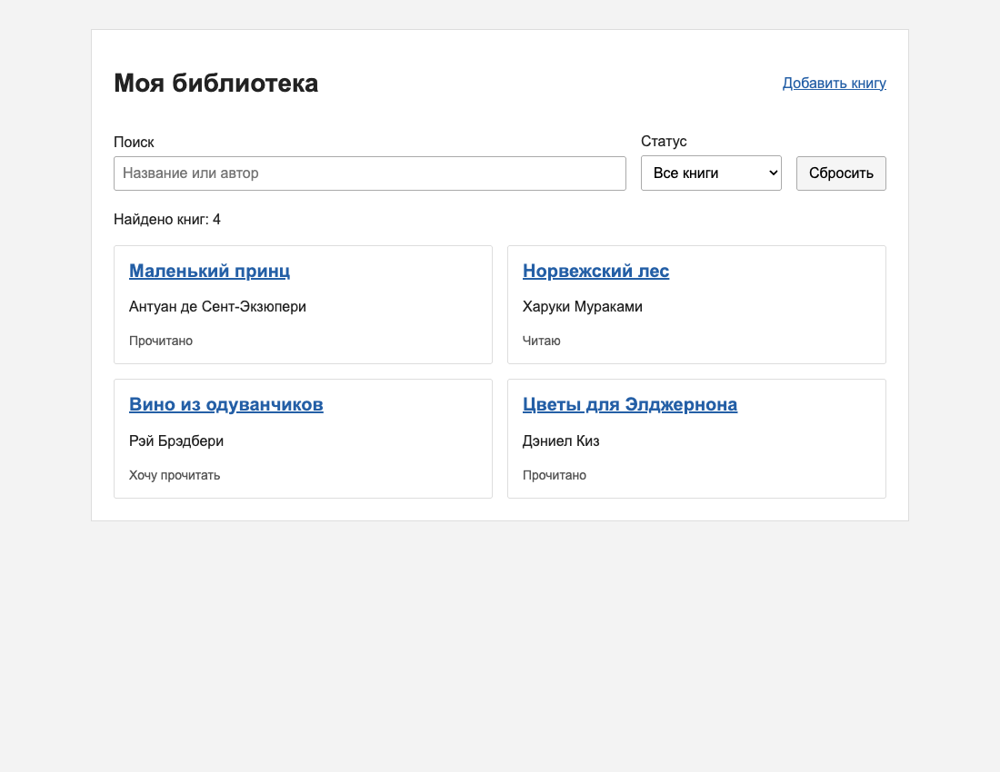
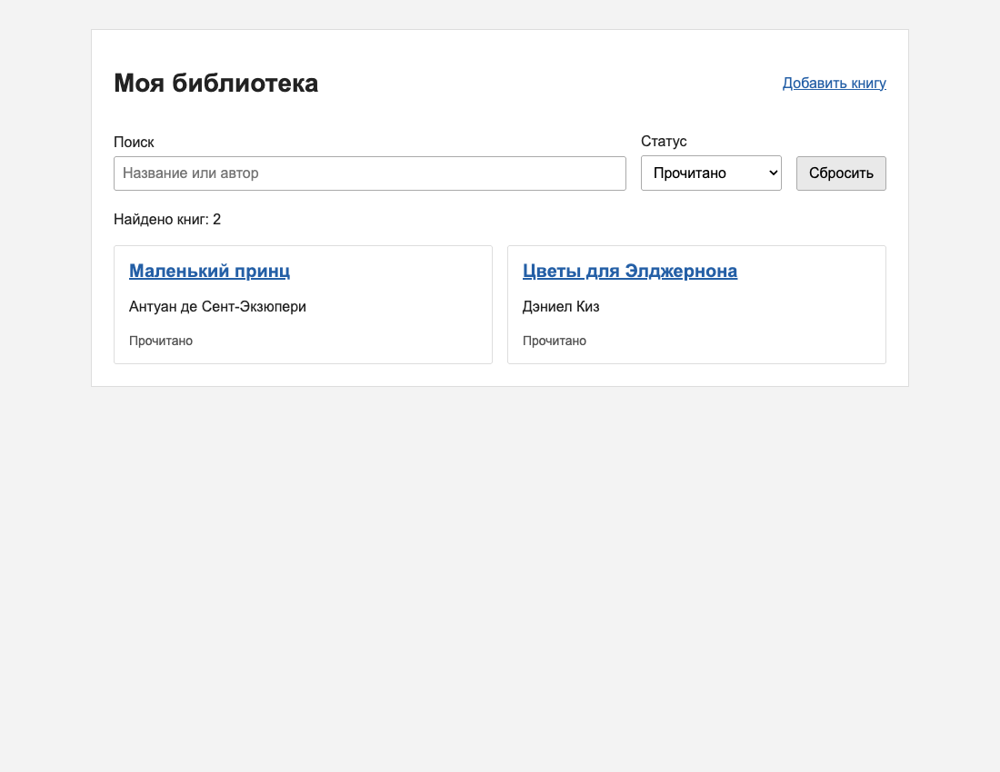
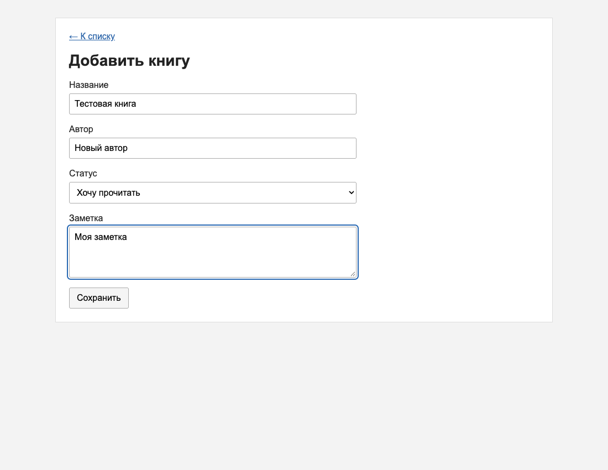
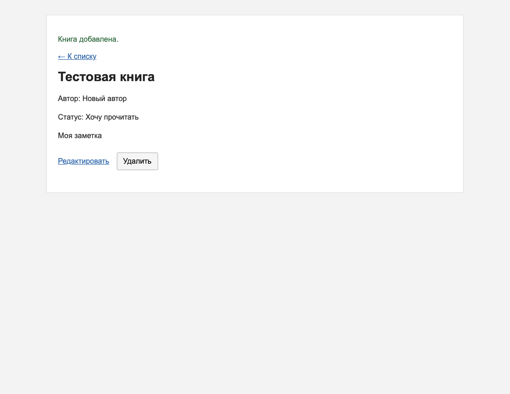
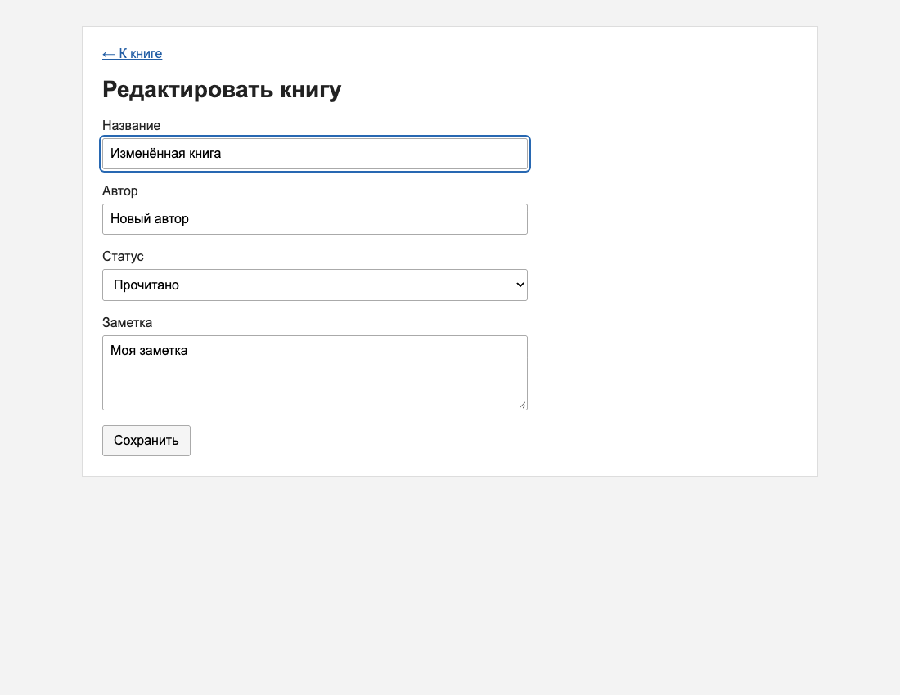
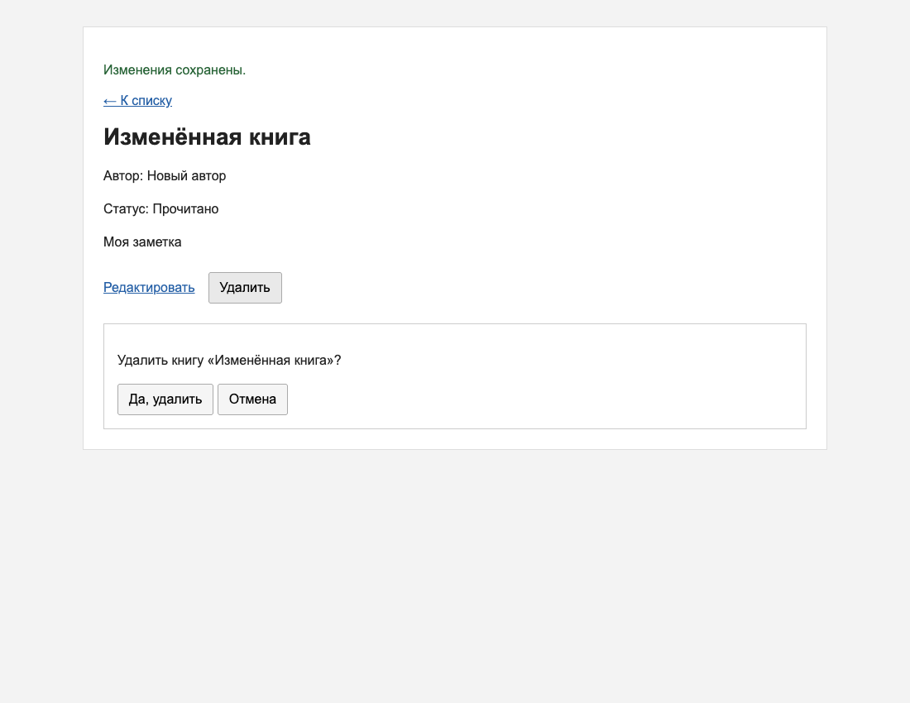
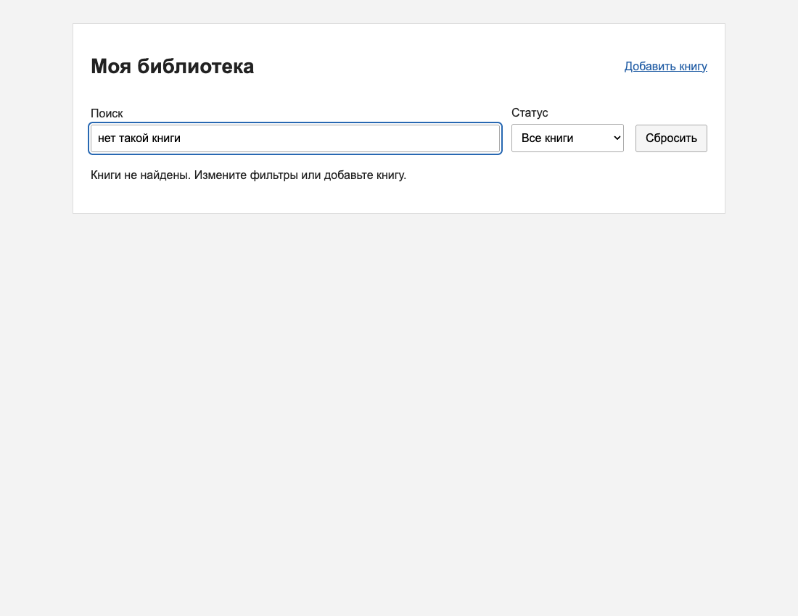
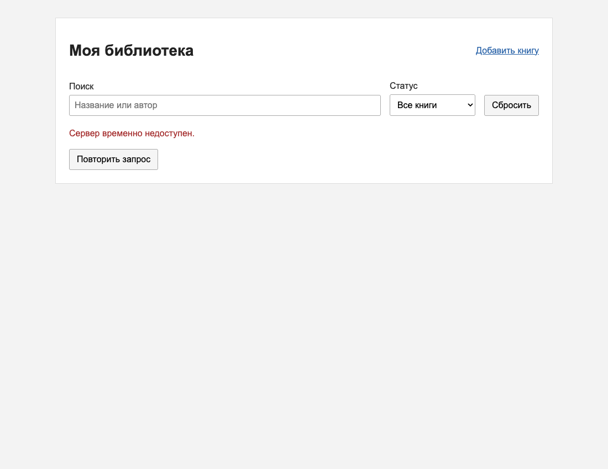
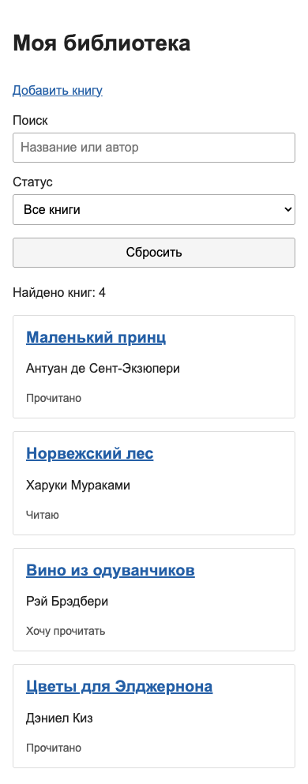

# Моя библиотека

Приложение для списка книг: просмотр, добавление, редактирование, удаление и поиск. Клиент написан на React и TypeScript, сервер — на Express. Данные хранятся в памяти сервера: после его перезапуска восстанавливаются четыре демонстрационные книги.

## Запуск

Нужны Node.js 22.12+ и pnpm 11.25.0. Установка pnpm: `npm install -g pnpm@11.25.0`.

Из папки проекта:

```bash
pnpm install --frozen-lockfile
pnpm dev
```

Клиент: http://127.0.0.1:5173/books. API: http://127.0.0.1:3001/api/books.
Обе части запускаются одной командой; Ctrl+C останавливает обе. Порты 3001 и 5173 должны быть свободны. Vite перенаправляет запросы `/api` на Express.

Сборка и запуск готового приложения:

```bash
pnpm build
pnpm start
```

Откройте http://127.0.0.1:3001/books. Express раздаёт собранный клиент и API с одного адреса. Прямое открытие и перезагрузка вложенных страниц поддерживаются.

## Страницы

| Адрес                            | Назначение             |
| -------------------------------- | ---------------------- |
| `/books`                         | Список книг            |
| `/books?q=принц&status=finished` | Поиск и фильтр статуса |
| `/books/1`                       | Отдельная книга        |
| `/books/new`                     | Добавление             |
| `/books/1/edit`                  | Редактирование         |

После сохранения открывается страница книги, после удаления — список. Неизвестный адрес показывает страницу «Страница не найдена». Поиск ищет подстроку в названии и авторе без учёта регистра. Параметры `q` и `status` сохраняются в адресной строке и восстанавливаются при перезагрузке. Статусы: `planned`, `reading`, `finished`. Фильтрация выполняется сервером.

## API

Все ответы с данными и ошибками — JSON. Для POST и PUT нужен заголовок `Content-Type: application/json`.

| Метод и путь                             | Результат                                          |
| ---------------------------------------- | -------------------------------------------------- |
| `GET /api/books`                         | Массив книг, 200                                   |
| `GET /api/books?q=принц&status=finished` | Отфильтрованный массив, 200; без совпадений — `[]` |
| `GET /api/books/:id`                     | Книга, 200; отсутствующая — 404                    |
| `POST /api/books`                        | Новая книга, 201 и заголовок Location              |
| `PUT /api/books/:id`                     | Полная замена полей книги, 200                     |
| `DELETE /api/books/:id`                  | Удаление, 204 без тела                             |

Пример тела создания и редактирования:

```json
{
  "title": "Новая книга",
  "author": "Автор",
  "status": "planned",
  "note": "Хочу прочитать"
}
```

Сервер создаёт `id`. Название и автор обязательны, не могут состоять из пробелов и ограничены 120 символами. Заметка обязательна в запросе, но может быть пустой; максимум 500 символов. Некорректные поля, JSON и параметры поиска возвращают 400, слишком большой запрос — 413, отсутствующая книга — 404. Ошибка имеет вид `{"message":"Описание ошибки"}`. Неизвестные параметры поиска отклоняются; `q` ограничен 200 символами.

## Структура и состояние

- `client/src/pages` — список, отдельная книга и страницы форм.
- `client/src/components` — общая контролируемая форма и отображение загрузки/ошибки.
- `client/src/api.ts` — запросы через fetch и async/await, проверка HTTP-статусов.
- `client/src/hooks/useRequest.ts` — состояние запроса и повторная загрузка.
- `server/books.ts` — маршруты, фильтрация и операции над книгами.
- `server/app.ts` — Express, обработка ошибок и раздача сборки.
- `shared/book.ts` — общие типы, проверка полей и демонстрационные данные.

Клиент получает книги только через HTTP. Форма хранит собственный черновик; во время сохранения поля и кнопка заблокированы. При ошибке черновик остаётся доступным. Загрузка, пустой результат и ошибка отображаются отдельно; для ошибки чтения есть кнопка повтора.

При изменении адреса предыдущий запрос отменяется через AbortController. Дополнительный признак актуальности не позволяет завершившемуся старому запросу изменить состояние. Пока новый адрес ещё загружается, данные старого адреса не показываются. При уходе со страницы запрос также отменяется.

## Проверки

```bash
pnpm test
pnpm exec playwright install chromium
pnpm test:browser
pnpm build
```

Тест API проверяет операции, фильтры, обязательные поля, ошибочный JSON и HTTP-статусы. Проверки в браузере охватывают создание, чтение по прямому адресу, редактирование, удаление и отмену удаления, фильтры в URL, перезагрузку, пустой результат, ошибку с повтором, конкурирующие запросы и сохранение черновика при ошибке. Для них нужны свободные порты 3001 и 5174.

## Демонстрация

[Короткое видео основных сценариев](docs/demo.webm).

Пример списка: четыре книги, две прочитаны. Для фильтрации выберите «Прочитано» или введите «принц». Откройте книгу, создайте новую, отредактируйте статус и удалите её. На проверке можно показать запросы во вкладке «Сеть» инструментов браузера.










